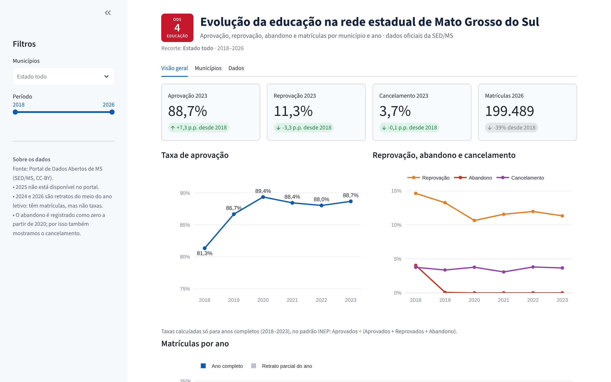
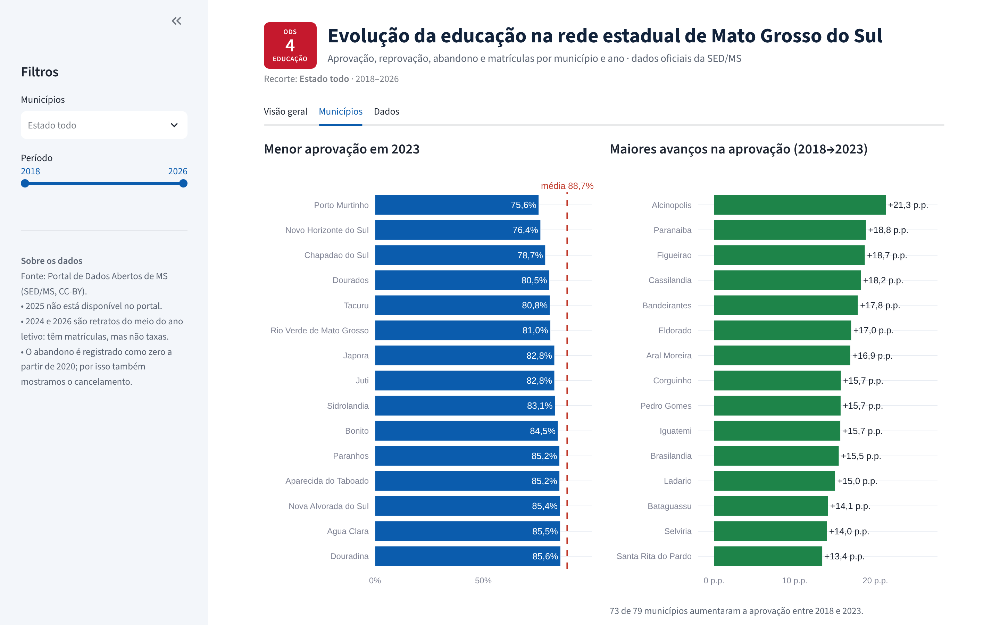
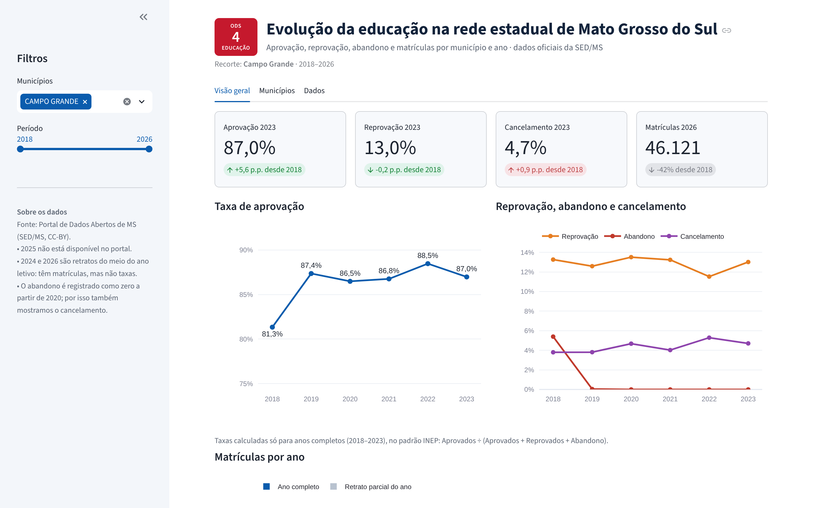
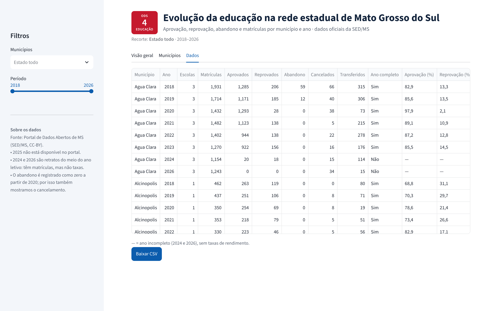

# Evolução da educação na rede estadual de MS — DAC ODS 4

Sistema que carrega os dados oficiais de matrículas e rendimento escolar da rede estadual de
Mato Grosso do Sul (2018–2026), armazena a série histórica em um banco SQL e apresenta um
dashboard com filtros por município e ano para responder: **a educação no estado está evoluindo?**

Desafio de Articulação de Competências (DAC) — ODS 4 (Educação de Qualidade) — UCDB, 4º semestre
de Ciência da Computação e Tecnologia em Análise e Desenvolvimento de Sistemas.
Professor referência: Renato Gil Arruda Vieira.

**Integrantes:** Breno Salazar, Giovana Tiemi, Manuela de Araujo, Maria Eduarda.



## Principais resultados

| Ano  | Aprovação | Reprovação | Abandono | Cancelamento | Matrículas |
|------|----------:|-----------:|---------:|-------------:|-----------:|
| 2018 | 81,3% | 14,6% | 4,0% | 3,8% | 326.367 |
| 2019 | 86,7% | 13,3% | 0,1% | 3,4% | 293.195 |
| 2020 | 89,4% | 10,6% | 0,0% | 3,8% | 242.028 |
| 2021 | 88,5% | 11,6% | 0,0% | 3,1% | 248.780 |
| 2022 | 88,0% | 12,0% | 0,0% | 3,8% | 247.646 |
| 2023 | 88,7% | 11,3% | 0,0% | 3,7% | 237.574 |

A aprovação subiu 7,3 pontos percentuais entre 2018 e 2023, e a reprovação caiu 3,3 p.p.
No mesmo período, as matrículas da rede estadual caíram 27%. Detalhes e limitações em
[`notas_dados.md`](notas_dados.md).

## Fonte dos dados

[Matrículas por Unidade Escolar](https://www.dados.ms.gov.br/dataset/matriculas-por-unidade-escolar) —
Portal de Dados Abertos de MS, Secretaria de Estado de Educação (SED/MS), licença Creative Commons
Atribuição. Uma linha por escola e ano, com matrículas e situação final dos alunos (aprovados,
reprovados, abandono, transferidos, cancelados etc.).

Limitações tratadas pelo sistema:

- Não existe arquivo de 2025 no portal.
- Os arquivos de 2024 e 2026 são retratos do meio do ano letivo (84% e 94% dos alunos "Cursando").
  O sistema considera completo um ano com menos de 5% de alunos cursando; nos incompletos, mostra
  matrículas mas não calcula taxas.
- O portal registra abandono zero em todas as escolas a partir de 2020. Por isso o dashboard exibe
  também a taxa de cancelamento como indicador complementar.

## Indicadores

Taxas calculadas no padrão do INEP (transferidos e falecidos ficam fora do denominador):

- Aprovação = Aprovados ÷ (Aprovados + Reprovados + Abandono)
- Reprovação = Reprovados ÷ (Aprovados + Reprovados + Abandono)
- Abandono = Abandono ÷ (Aprovados + Reprovados + Abandono)
- Cancelamento = Cancelados ÷ (Aprovados + Reprovados + Abandono + Cancelados)

## Como executar

Requisitos: Python 3.11 ou superior e Git.

```bash
git clone https://github.com/nyuwk/dac-ods4-educacao-ms.git
cd dac-ods4-educacao-ms
python -m venv .venv
.venv\Scripts\activate          # Windows
# source .venv/bin/activate     # Linux / macOS
pip install -r requirements.txt

python -m scripts.carregar_banco  # cria educacao_ms.db a partir dos CSVs
streamlit run app.py              # abre o dashboard em http://localhost:8501
```

Os CSVs já estão em `data/raw/`. Para baixá-los de novo do portal: `python scripts/baixar_dados.py`.

## Arquitetura

```
data/raw/            CSVs originais (2018–2024 e 2026)
sql/schema.sql       tabelas municipio, escola, registro_anual + view vw_indicadores_municipio
src/models.py        classes RegistroAnual, Escola e Municipio
src/loader.py        CarregadorCSV: leitura, normalização de nomes e montagem dos objetos
src/database.py      conexão SQLite, criação do schema e gravação
src/repository.py    RepositorioEscolar: consultas usadas pela interface
scripts/             download dos dados e carga do banco
app.py               dashboard Streamlit
docs/img/            prints do sistema
.streamlit/          tema visual do dashboard
```

Fluxo: **CSV → CarregadorCSV → objetos em memória → SQLite → RepositorioEscolar → dashboard**.

- **Orientação a objetos:** `RegistroAnual` guarda os números de uma escola em um ano e calcula suas
  taxas; `Escola` agrupa seus registros por ano; `Municipio` agrupa suas escolas.
- **Estruturas de dados:** dicionários `município → escolas` e `escola → {ano: registro}` permitem
  busca em tempo O(1) médio e evitam duplicar escolas que aparecem em vários anos; a série histórica
  de cada escola é devolvida como lista ordenada por ano.
- **Banco relacional:** três tabelas normalizadas com chaves estrangeiras e restrição
  `UNIQUE (escola_id, ano)`, mais uma view que agrega os indicadores por município e ano.
- **Identificação das escolas:** o dataset não tem código INEP; a escola é identificada pelo nome
  normalizado (maiúsculas, sem acentos, sem espaços repetidos) dentro do município.

Carga verificada: 3.703 registros, 79 municípios e 598 escolas distintas.

## Prints

| Visão geral (estado, 2018–2026) | Comparação entre municípios |
|---|---|
|  |  |
| **Filtro por município (Campo Grande)** | **Dados filtrados** |
|  |  |
